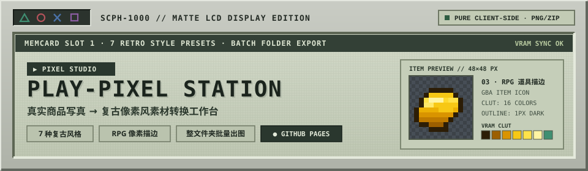

<p align="center">
  <a href="https://ninepoin4.github.io/ps1-pixel-studio/">
    
  </a>
</p>

<p align="center">
  <strong>纯前端 · 零上传 · 低眩光 PS1 / LCD 液晶风商品图转像素素材工具</strong><br />
  <a href="https://ninepoin4.github.io/ps1-pixel-studio/">▶ 立即在线打开（GitHub Pages）</a>
</p>

---

## 简介

把真实商品照片一键转换成可直接用作游戏道具、复古贴纸与创意视觉的像素风素材——所有处理均在本地浏览器 `<canvas>` 完成，无需上传服务器。

## 核心特性

- **7 种复古风格一键切换**
  - `01 · 低分截图像素风`：模拟低分辨率窗口截图再无损放大，保留柔和光影
  - `02 · 保留本色精致风`：智能提取商品主色 + 锐利透明边界
  - `03 · RPG 道具描边风`：高饱和索引色 + `1px` 自适应深色外描边
  - `04 · PS1 15-bit 抖动`：RGB555 硬件色深 + `4×4` Bayer 矩阵抖动
  - `05 · 经典掌机 4 色`：亮度自适应映射 Game Boy DMG 4 阶橄榄绿
  - `06 · PICO-8 卡带风`：PICO-8 16 色硬件调色板 + 1px 黑边
  - `07 · PC-98 杂志扫描`：16 色 + Floyd-Steinberg 误差扩散颗粒
- **低眩光反射式 LCD 界面**：提供并排对比、拉帘对比（`◀ WIPE ▶`）、成片预览、RPG 道具框展示与 `LCD 点阵` 纹理开关。
- **Memory Card 槽位管理**：支持拖拽单图或**整个文件夹**、粘贴（`Ctrl+V`）、单张 `×` 删除、清空及 `Ctrl+Z` 撤销。
- **批量出图**：支持 `1× / 4× / 8× / 16×` 无损 PNG 导出、**一键打包 `.zip` 下载**、以及写入本地目标文件夹，并可生成 `7 风格拼接对比图`。

## 本地运行

```bash
# 方式 1：直接用浏览器打开 index.html（完全离线可用）
# 方式 2：启动静态服务（可在 Chrome/Edge 中启用「写入文件夹」功能）
python -m http.server 8787
```
